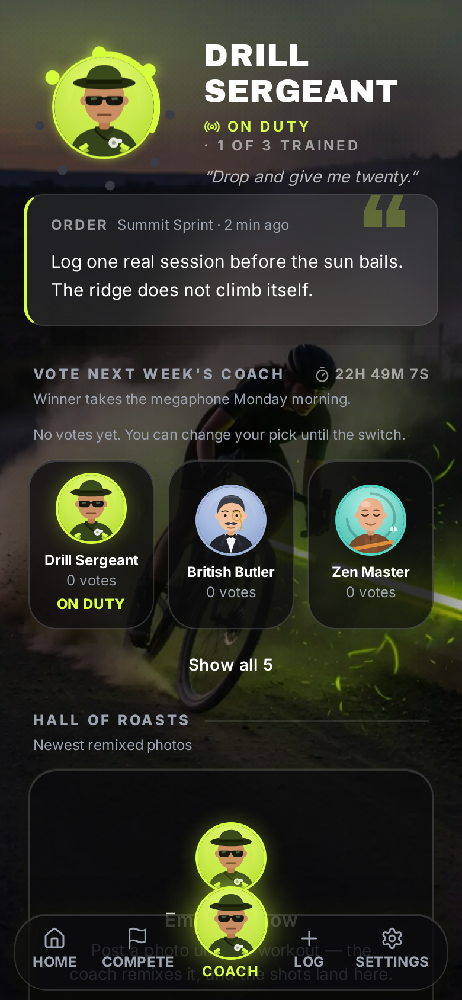
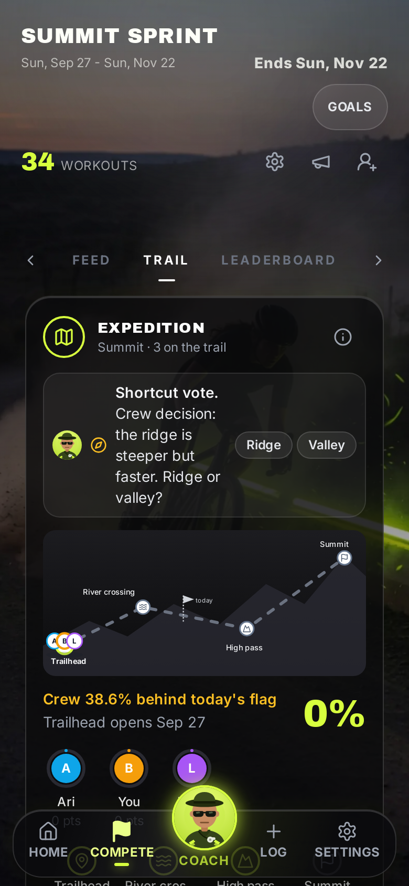
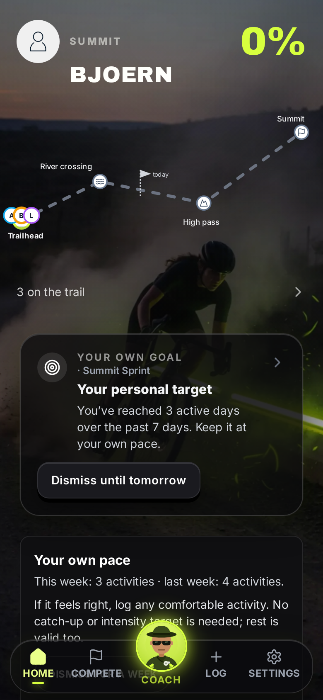
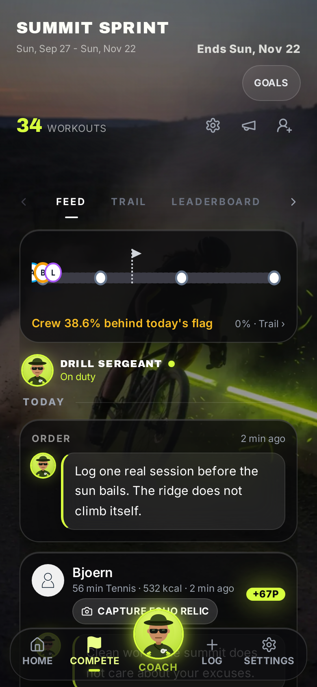
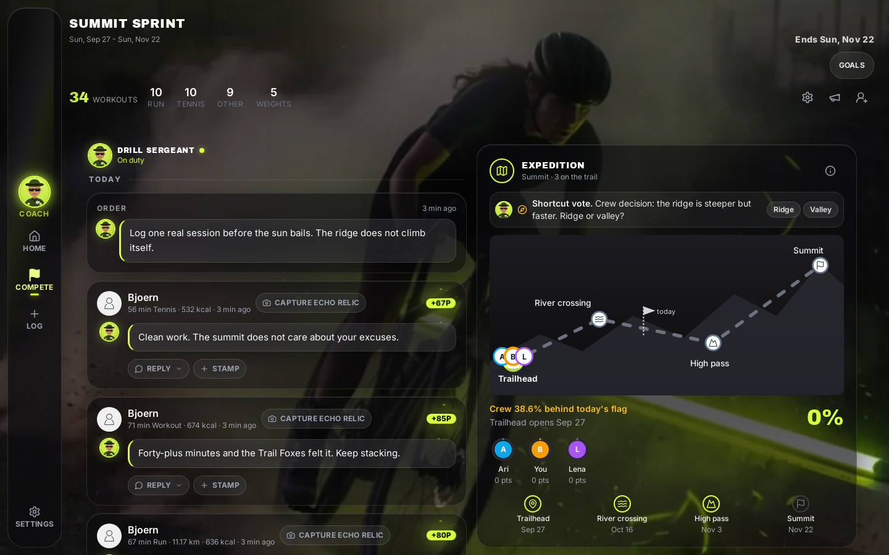

# Workout Challenge

> ### ⚠️ This is a fork
> **Original project:** [vanalmsick/workout_challenge](https://github.com/vanalmsick/workout_challenge) — Copyright © 2025 [github.com/vanalmsick](https://github.com/vanalmsick).  
> This fork is maintained at [bandulix/workout_challenge](https://github.com/bandulix/workout_challenge).  
> Both are licensed under the **Server Side Public License v1 (SSPL)** — see [LICENSE](LICENSE) and [NOTICE](NOTICE). What this fork changes: [CHANGELOG.md](CHANGELOG.md) and [below](#changes-from-the-original).
>
> 🤖 This fork was vibe-coded — designed and built with AI assistance, guided and reviewed by a human.

# Your crew. Your coach. Your trail.

**Workout Challenge** is the self-hosted fitness rivalry that talks back.

An **AI Drill Instructor** comments on every workout, remixes your photos, and pings your lock screen. Turn a challenge into a shared **Expedition** — the crew climbs a summit, crosses an ocean, or races a storm together. Sync **Strava, Garmin, or Health Connect**. Install the **PWA** or the **Android APK**. Your data stays on *your* server.

<p align="center">
  <a href="docs/imgs/preview-mobile-coach-dark.png"></a>
  <a href="docs/imgs/preview-mobile-trail-dark.png"></a>
  <a href="docs/imgs/preview-mobile-myspace-dark.png"></a>
</p>
<p align="center"><i>Coach · Expedition Trail · Home</i></p>

---

## Killer features

### 🗣️ A coach, not a spreadsheet
Personas roast, cheer, and nudge — Drill Sergeant, Roast Master, Zen, Butler, Cheerleader, or your own custom coach with portrait + full-body shots so remixes look like *them*. Stamp a workout (WTF!, GOAT, Oof…). **Order of the Day** follows a private readiness score (Green push, Amber technique, Red recovery — the sergeant can be sharp on a red day and still cannot order an all-out). **Hall of Roasts**, **Legend Echoes** (beat the mark, take the relic — 3 takeovers make it immortal; the photo *is* the relic). Weekly coach vote in the last 72 hours before Monday. Owners can brief the coach with a daily topic. Formula, sources, and privacy: [docs/readiness.md](docs/readiness.md).

### 🗺️ Expedition — the season is a route
Flip *Expedition* on and the crew’s points move everyone along a themed trail (summit, ocean, desert, space, relay). Landmarks land on the calendar; the finale waits for the last day. Rescue runs, base camps, treasure hunts, storm/rope weeks, and shortcut votes keep seasons different. Close with a postcard and one-tap rematch.

### 🏠 Home that moves you (without shaming you)
One named rival and what would close the gap. A private comeback note when your week goes quiet — never a public call-out. Opt-in nudges from challenge-mates. Season-first Home puts the trail under your name.

### ⌚ Any watch, no lock-in
**Strava**, **Garmin Connect**, or **Apple Health / Google Health Connect**. One activity source per athlete so nothing is counted twice.

### 📐 Your rules, your host
Custom goals, teams, caps, live leaderboard — **1 point per 1% of a goal**. Docker Compose. PWA on any phone; sideload APK for one-tap Health Connect.

<p align="center">
  <a href="docs/imgs/preview-mobile-competition-dark.png"></a>
  <a href="docs/imgs/preview-competition-dark.png"></a>
</p>
<p align="center"><i>Challenge feed · Desktop (feed + trail)</i></p>

---

## Try it in three commands

```bash
git clone https://github.com/bandulix/workout_challenge.git
cd workout_challenge
cp .env.example .env
```

Set at least these in `.env` (generate a Django secret with the one-liner in `.env.example`):

```bash
SECRET_KEY=…                 # required
POSTGRES_PASSWORD=…          # required
FLOWER_PASSWORD=…            # required, MUST differ from SECRET_KEY
DEBUG=true                   # local try-out only — never on a public host
APP_BIND=0.0.0.0
APP_PORT=8080
MAIN_HOST=http://localhost:8080
HOSTS=http://localhost:8080,http://127.0.0.1:8080,https://localhost
```

```bash
docker compose up -d
# wait ~30s for migrations, then seed a demo challenge + workouts:
docker compose exec workoutchallenge python manage.py add_dummy_data
```

Open **http://localhost:8080** and sign in:

| Email | Password |
| --- | --- |
| `user1@admin.local` | `password` |
| `user2@admin.local` | `password` |
| `user3@admin.local` | `password` |

First user is staff. Tap **Coach**, **Compete → Trail**, and **Home** to see the killer loop.

> Production: set `DEBUG=false`, put a TLS reverse proxy in front (`APP_BIND=127.0.0.1`), and set `MAIN_HOST` / `HOSTS` to your public **HTTPS** origin (plus `https://localhost` for the Android app). Never leave a reachable instance on `DEBUG=true`.

Update later: `git pull && docker compose pull workoutchallenge && docker compose up -d`.

Image: [`ghcr.io/bandulix/workout_challenge`](https://github.com/bandulix/workout_challenge/pkgs/container/workout_challenge). The Docker Hub image `vanalmsick/workout_challenge` is the original app, not this fork.

---

## Optional setup

**Accounts** — with `REGISTRATION_TOKEN` empty, anyone can sign up and the first account is staff. Set a token to close registration, then `docker compose exec workoutchallenge python manage.py createsuperuser` (or `promotetostaff user@example.com`). Challenge invite links (`?join=`) still work. Point factors live at `/admin/site-settings`; LLM, Strava, and SMTP are `.env`-only.

**Email** — SMTP in `.env`. New accounts confirm the address before welcome / weekly mail.

**AI coach** — challenge owner: megaphone on the challenge page → pick a persona → activate. Any OpenAI-compatible LLM via `LLM_*` in `.env` (an image-capable model or a dedicated `LLM_IMAGE_*` model enables photo remixes). Push: Coach page → Enable coach pings.

**Expedition** — challenge owner: Edit challenge → *Expedition* on, pick objective and theme ("Surprise me" rotates). Locked once the route has started; participants see it on the challenge’s **Trail** tab.

**Strava** — [create an API app](https://www.strava.com/settings/api). Since June 2026 Strava requires a paid subscription for Standard-Tier API access; Health Connect needs no Strava at all.

**Garmin** — link in Settings. The password is used once; only an encrypted token is stored.

**Apple Health / Google Health Connect** — no cloud API, so this stack can run a self-hosted [Open Wearables](https://github.com/the-momentum/open-wearables) instance (MIT, © Momentum; not vendored here — see [NOTICE](NOTICE)):

```bash
# .env: OW_POSTGRES_PASSWORD, OW_SECRET_KEY and OW_ADMIN_PASSWORD
# (OW_SECRET_KEY / OW_ADMIN_PASSWORD must differ from Django's SECRET_KEY)
docker compose --profile health up -d
```

Phones reach it at `MAIN_HOST/health` by default. In the Android app, Health Connect is one tap. In a browser, Settings shows a connection code for a health app on the phone.

**Android APK** — GitHub Releases, or `scripts/build_apk.sh`. One APK works on every instance: enter the server address on first start. After pulling a new image, publish the matching APK with `scripts/update_apk_from_release.sh`. Foldables (Galaxy Z Fold/Flip class) are supported: the activity is resizable, survives fold/unfold without losing state, draws around cutouts, and the dock avoids the hinge in dual-screen posture.

Secrets at rest and backup notes: [docs/security-secrets-and-backups.md](docs/security-secrets-and-backups.md). Quick backups (DB + uploads): `scripts/backup.sh` — always before an upgrade.

---

## Develop / test the code

```bash
# Backend suite (SQLite + in-memory cache — no Docker required)
cd src-backend && python manage.py test --settings=workout_challenge.test_settings
cd src-backend && ruff check .

# Frontend
cd src-frontend && npm test && npx eslint src
```

Backend migrations for `competition`, `workouts` and `custom_user` live in `src-backend/db_migrations/` (outside the runtime data volume so a named volume can’t shadow them). CI gates every push on both suites and builds the Docker image + signed APK on release. Product direction for Expedition and the retention loop: [docs/expedition-product-roadmap.md](docs/expedition-product-roadmap.md).

Seed a richer local UI (coach + expedition + workouts) while developing with `DEBUG=true`:

```bash
cd src-backend && python manage.py migrate && python manage.py add_dummy_data
```

---

## Changes from the original

This fork extends [vanalmsick/workout_challenge](https://github.com/vanalmsick/workout_challenge) (base `main` @ `256e5b1`) under the same SSPL v1. Original copyright is untouched. Full list: [CHANGELOG.md](CHANGELOG.md).

- **AI Drill Instructor** — persona comments, stamps, Order of the Day (readiness-banded and private to the athlete; see [docs/readiness.md](docs/readiness.md)), Hall of Roasts, Legend Echoes on the workout (sport-family relics, takeovers announced, 3 defenses to immortal), weekly coach vote (72h window), photo remixes, owner-defined daily briefings, native share sheet, web push / Android pings.
- **Expedition & seasons** — shared themed routes with objectives and weekly twists, crew view, finale postcard, archive and rematch.
- **Retention without shaming** — Close-the-Gap rival card, private comeback bench with opt-in peer nudges; public dunce/last-place mechanics removed.
- **Coach-centred PWA** — glass dock, Coach as home, daily action plates, dark theme, private uploaded photos.
- **Garmin Connect** and **Apple Health / Health Connect** (via Open Wearables) next to Strava — one shared sport-type table, so the same workout counts the same from every watch; one activity source per user.
- **Sideload Android app** with one-tap Health Connect.

License: [LICENSE](LICENSE) (SSPL v1). Fork and third-party notices: [NOTICE](NOTICE).
